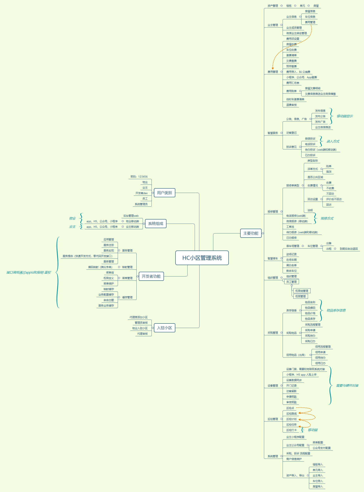
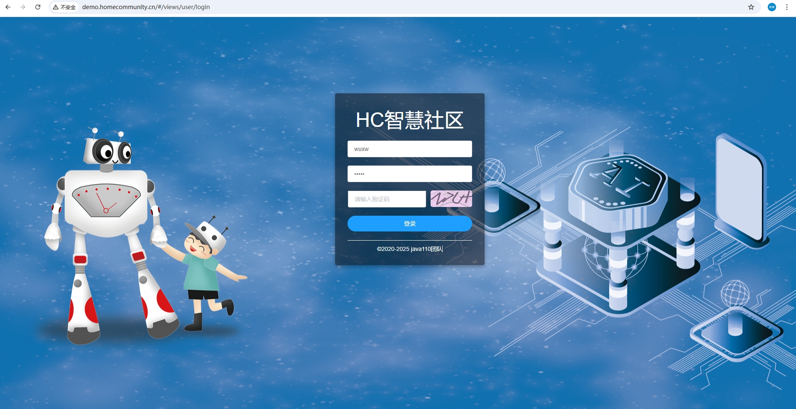
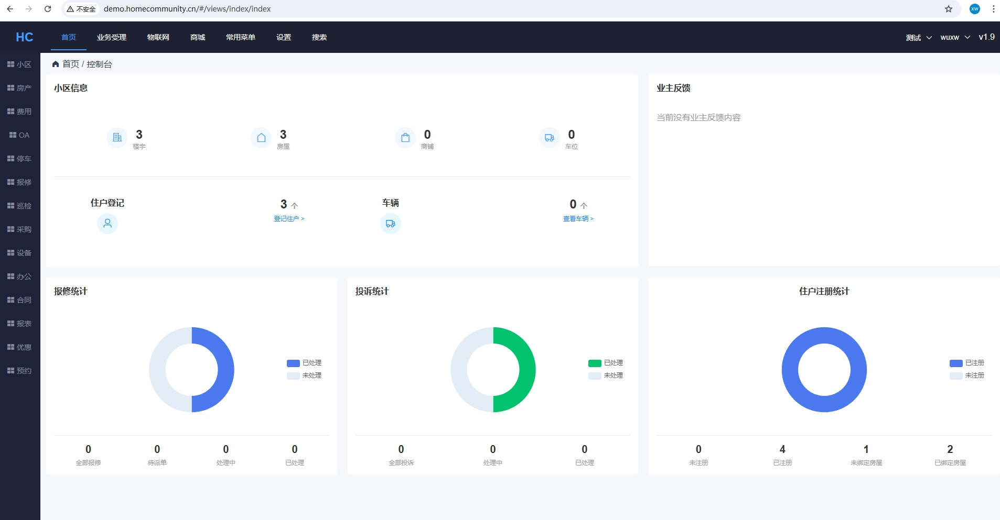
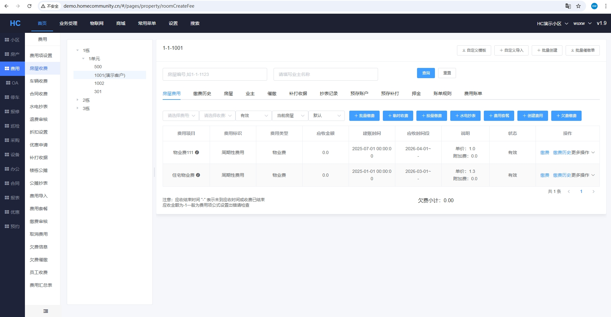
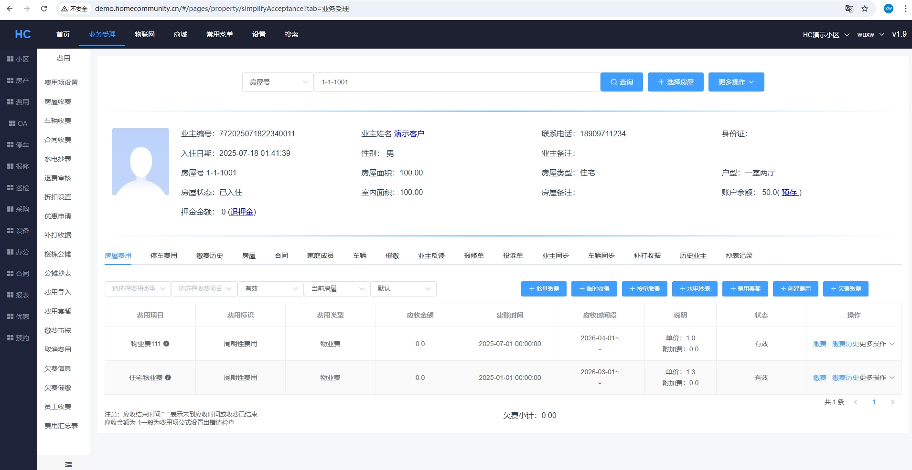
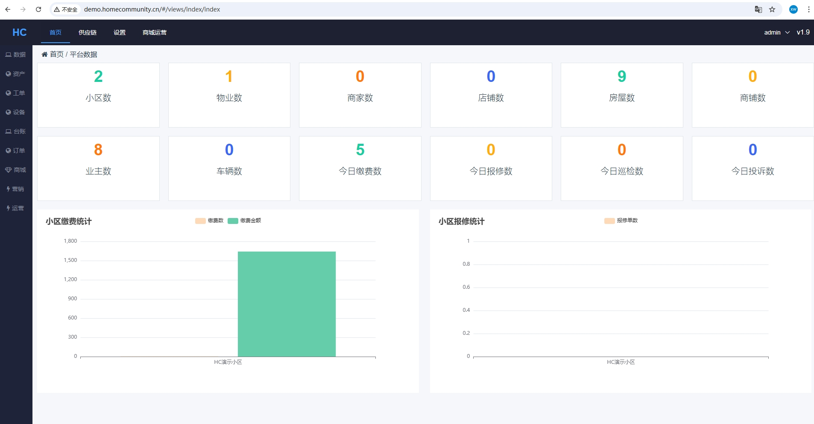
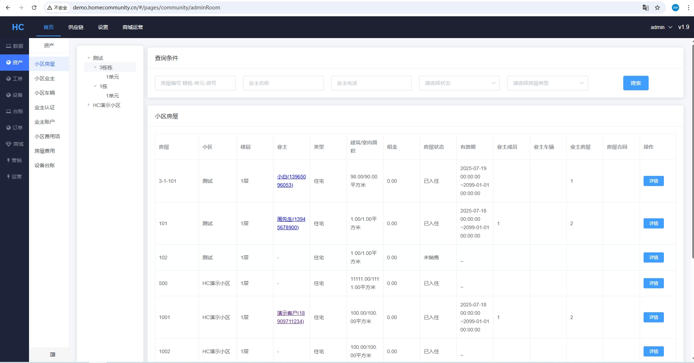
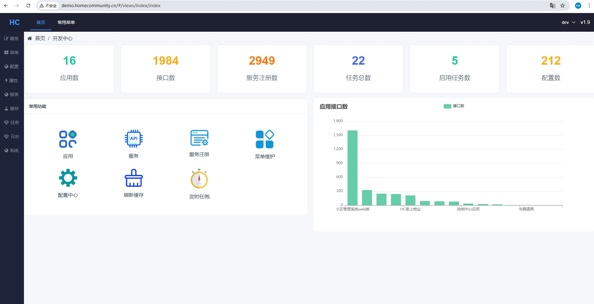
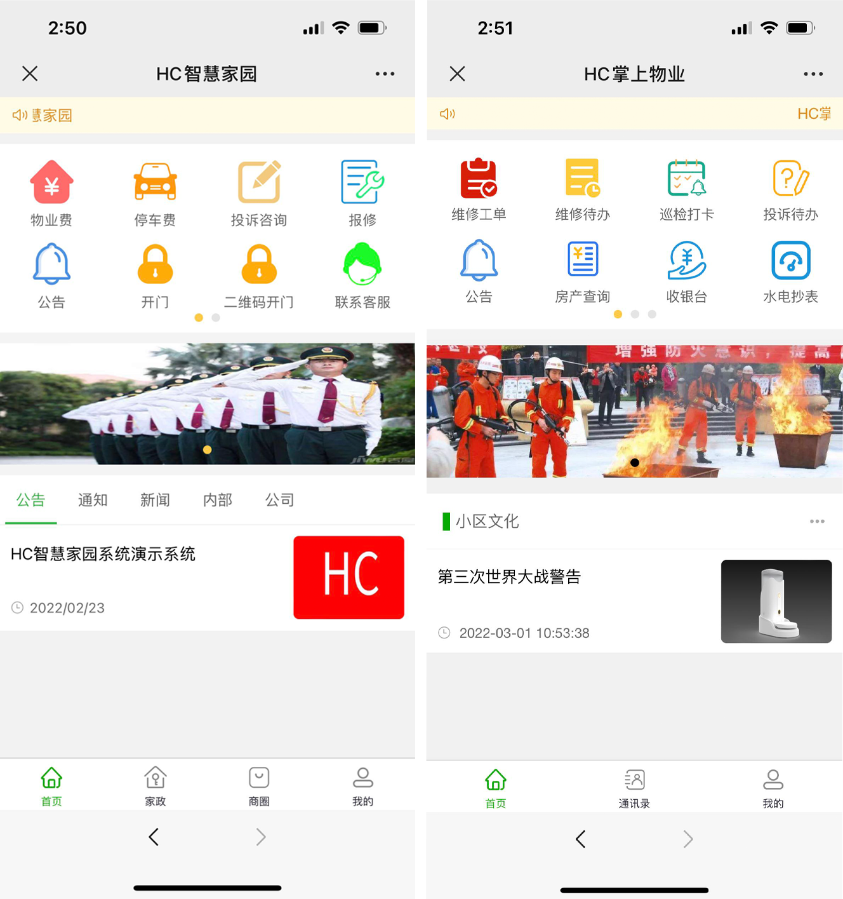

# HC物业管理系统pcweb端（vue2+elementui）

## 说明
 HC小区管理系统是一套saas物业管理的系统，包括 房产、业主、 费用 （可以线上缴费）、报修（可以线上报修）、投诉建议、采购、巡检、停车、门径、道闸、监控、工作流、问卷和公告等功能。
 
 相关代码：<br/><br/>
 1、[物业系统前端](https://gitee.com/java110/MicroCommunityWeb) : 物业员工使用电脑端<br/>
 2、[物业系统后端](https://gitee.com/wuxw7/MicroCommunity): 核心业务处理端<br/>
 3、[业主手机端](https://gitee.com/java110/WechatOwnerService): 提供用户使用，包括投诉 建议，缴费、报修 等<br/>
 4、[物业手机版](https://gitee.com/java110/PropertyApp): 物业员工使用手机端<br/>

## 如何使用

[操作手册](http://www.homecommunity.cn/pages/hc/addCommunity_cn.html)

## 产品

1、手机端演示环境

   

2、电脑端<br/>
地址：http://demo.homecommunity.cn <br/>
管理员账号：admin/admin<br/>
物业演示账号:wuxw/admin<br/>
开发者账号：dev/密码自己修改 [如何修改](http://bbs.homecommunity.cn/pages/bbs/topic.html?topicId=102021110520080050)

## 系统功能（function） 

   
   
   主要系统功能请查看
     
   [功能清单](http://bbs.homecommunity.cn/pages/bbs/topic.html?topicId=102022042459860343)

## 目录介绍
public 存放静态图片，src 下存放代码，这里主要介绍src 目录
```
src
   api  # 存放调用后端的接口
   components  # 存放vue组件页面
   conf # 主要系统配置
   i18n # 国际化配置文件
   router # 配置页面路由文件
   utils  # 前段工具存放
   views  # 存放前段页面
```

## 架构
vue2+elementui

## 安装

### 开发启动
## 开发启动
```
npm run dev 
```
首次启动时 需要执行
```
npm install .
```
安装依赖

### 生产安装

[快速安装](./install.md)


## 运行效果（view）
1.在浏览器输入 http://localhost:3000/ 如下图



    用户名为 wuxw 密码为 admin  如下图

    点击登录，进入如下图：













## 参与贡献

您可以fork 代码后，commit后 pull request合并代码

联系作者：17797173942（微信号）